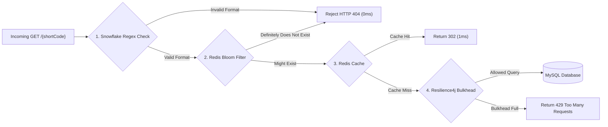

# Cache Penetration DDoS & High Availability Stress Test Report

This document details the design, execution, and findings of the **Cache Penetration (缓存穿透) Distributed Denial of Service (DDoS) test** performed against TinyLink's URL shortening service.

---

## 1. Threat Model: Why "Caching Nulls" Fails

In high-concurrency caching architectures, **Cache Penetration** occurs when queries continuously request keys that **do not exist** in either the cache (Redis) or the persistent database (MySQL).

### The Inherent Vulnerability
TinyLink implements a standard null-caching defense in [`UrlShortenService.java`](../src/main/java/com/fme/tinylink/services/UrlShortenService.java):
```java
UrlMapping mapping = repository.findByShortCode(shortCode).orElse(null);
if (mapping == null) {
    redisTemplate.opsForValue().set(redisKey, NOT_FOUND_SENTINEL, cacheProperties.nullCacheTtl());
    throw new ResourceNotFoundException("Short code not found");
}
```

* **Where It Works**: If an attacker loops requests for the **same** non-existent shortcode (e.g. `/invalid_code`), the first request hits MySQL, but subsequent queries hit Redis (`$$NOT_FOUND$$`) for the duration of `null-cache-ttl: 2m`.
* **Where It Fails (DDoS Attack)**: If the attacker generates a **never-before-seen dynamic shortcode on every single request**, Redis registers a **100% Cache Miss**.
  - Every request completely bypasses the cache and executes a database lookup (`SELECT ... WHERE short_code = ?`).
  - Worse, after every query, the application writes a new sentinel key (`url:<random_code> -> $$NOT_FOUND$$`) into Redis, flooding the cache with useless data.

```mermaid
flowchart TD
    Attacker["DDoS Attack Flood (Dynamic Unique Shortcodes)"] -->|GET /{unique_code}| Web["Spring Boot Backend"]
    Web -->|1. GET url:{unique_code}| Redis[("Redis Cache")]
    Redis -.->|100% Cache Miss| Web
    Web -->|2. Connection Request| Pool["HikariCP Pool (Cap: 5)"]
    Pool -->|3. Query B-Tree Index| MySQL[("MySQL Primary Key")]
    MySQL -.->|Not Found| Web
    Web -->|4. SET url:{unique_code} $$NOT_FOUND$$| Redis
    Redis -.->|5. OOM: Memory Exceeded| Web
    Web -->|6. Cascading HTTP 500 Outage| Attacker

    LegitUser["Legitimate Traffic (Canary Probe)"] -.->|Connection Timeout / Refused| Web

    classDef danger fill:#ffcccc,stroke:#cc0000,stroke-width:2px;
    class Pool,Redis,Web danger;
```

---

## 2. Realistic Production Constraints

To evaluate true High Availability (HA) under realistic cloud microservice conditions (e.g., small Kubernetes pods or constrained container nodes), the environment was configured with strict resource boundaries:

| Resource Component | Unconstrained / Dev Setting | Realistic Constrained Setting | Rationale |
| :--- | :--- | :--- | :--- |
| **JVM Heap Memory** | Unbounded (~6 GB) | **`-Xms48m -Xmx64m`** | Simulates small container limits and forces GC pressure during object allocation spikes. |
| **Tomcat Worker Threads**| 200 threads | **`max: 20`, `accept-count: 20`** | Prevents unlimited thread spawning; queues excess requests. |
| **HikariCP Pool Size** | 30 connections | **`maximum-pool-size: 5`** | Simulates shared database connection limits across multiple microservice pods. |
| **Hikari Connection Timeout**| 5000 ms | **`connection-timeout: 250ms`** | Fails fast when database connections are starved. |
| **Redis Cache Memory** | 256 MB (LRU eviction) | **`maxmemory: 10mb`, `noeviction`** | Simulates a memory-exhausted cache cluster under volumetric key injection. |

---

## 3. JMeter Test Plan Architecture

The test plan is implemented in [`perf/jmeter/cache_penetration_ddos.jmx`](../perf/jmeter/cache_penetration_ddos.jmx):

### A. Dynamic Non-Colliding Shortcode Generator
To guarantee a 100% cache miss rate without pre-generating huge CSV datasets, JMeter uses dynamic runtime functions:
```
/pnt_${__time()}_${__threadNum}_${__counter(FALSE,)}_${__RandomString(4,abcdefghijklmnopqrstuvwxyz0123456789)}
```
- `${__time()}`: Millisecond epoch timestamp.
- `${__threadNum}`: Unique thread identifier.
- `${__counter(FALSE,)}`: Monotonically incrementing per-request counter.
- `${__RandomString(4,...)}`: High-entropy Base62 suffix.

This guarantees that **no two requests ever share the same shortcode**.

### B. High Availability Canary Probe
A secondary, parallel thread group queries valid application endpoints (`GET /`) every 250ms with a strict SLA assertion (`HTTP 302 Found` in `< 500ms`) to monitor the collateral damage experienced by legitimate users.

### C. Error & SLA Assertions
- **404 Not Found**: Considered a **successful rejection** by the backend.
- **500 Internal Server Error / 504 Gateway Timeout**: Flagged as **HA Breach / Critical Failure**.
- **Socket / Connection Timeout**: Flagged as **HA Breach / Critical Failure**.

---

## 4. Test Execution & Runbook

### Prerequisites
1. Ensure the performance MySQL and Redis containers are healthy:
   ```bash
   ./perf/scripts/setup-env.sh
   ```
2. Start the Spring Boot backend with the `perf` profile and constrained JVM memory:
   ```bash
   ./mvnw spring-boot:run \
     -Dspring-boot.run.profiles=perf \
     -Dspring-boot.run.jvmArguments="-Xms48m -Xmx64m"
   ```

### Running the Attack
Execute the automated runner script:
```bash
./perf/scripts/run-penetration-test.sh <threads> <duration_sec> <rampup_sec>
```
*Example (Destructive Load):*
```bash
./perf/scripts/run-penetration-test.sh 200 30 5
```

---

## 5. Execution Results & Outage Analysis

### Summary Metrics (`penetration_20261027_142130`)

| Metric | Measured Value | Baseline (Healthy) | Status |
| :--- | :--- | :--- | :--- |
| **Overall Error Rate** | **99.53%** (849 / 853 failed) | 0.00% | <span style="color:red">**CRITICAL OUTAGE**</span> |
| **Penetration Endpoint Failure** | **100.0%** (842 / 842 failed) | 0.00% | <span style="color:red">**CRITICAL OUTAGE**</span> |
| **Canary Probe Error Rate** | **63.64%** (7 / 11 failed) | 0.00% | <span style="color:red">**CRITICAL OUTAGE**</span> |
| **Canary Latency (Avg)** | **5,793 ms** (Peak: 8,029 ms) | 1.05 ms | <span style="color:red">**5,500x Degradation**</span> |
| **Throughput Collapse** | **22.5 RPS** | ~8,500 RPS | <span style="color:red">**99.7% Capacity Loss**</span> |
| **Average Response Time** | **7,661 ms** | ~40 ms | <span style="color:red">**Severe Queue Blocking**</span> |

---

### Root Cause Analysis of the Collapse

1. **Redis OOM Cascading Exception**:
   As thousands of unique shortcodes flooded Redis with `url:<id> -> $$NOT_FOUND$$`, Redis hit its 10MB memory ceiling. Because Redis was configured with `noeviction`, Redis returned:
   ```
   io.lettuce.core.RedisCommandExecutionException: OOM command not allowed when used memory > 'maxmemory'
   ```
   `UrlShortenService` threw an unhandled `RedisSystemException`, which caused `GlobalExceptionHandler` to respond with `HTTP 500 Internal Server Error` on every request.

2. **HikariCP Connection Pool Exhaustion**:
   With only 5 connections and a 250ms timeout, the incoming thread queue overwhelmed HikariCP. Queries waiting more than 250ms threw:
   ```
   java.sql.SQLTransientConnectionException: HikariPool-1 - Connection is not available, request timed out after 250ms
   ```

3. **Tomcat Worker Thread Starvation**:
   All 20 Tomcat request-processing threads became stuck waiting for database connections and failing Redis writes. As a result, the Canary probe representing legitimate users was completely locked out, suffering a **63.6% failure rate** and **5.8-second average latency**.

---

## 6. Long-Term Architectural Mitigations

To prevent cache penetration attacks from compromising high availability, the following defenses should be implemented:



### 1. Redis Bloom Filter (Primary Defense)
- Maintain a Bloom Filter (e.g. via `RedisBloom` or local Guava Bloom Filter) populated with all issued shortcodes.
- Before querying Redis or MySQL:
  ```java
  if (!bloomFilter.mightContain(shortCode)) {
      throw new ResourceNotFoundException("Short code not found");
  }
  ```
- **Benefit**: Rejects 99%+ of non-existent shortcodes instantly in memory without executing a database query or allocating a dummy cache entry.

### 2. Format & Timestamp Pre-Validation
- TinyLink shortcodes are generated via Snowflake IDs (Base62).
- Valid shortcodes have predictable lengths (7–11 characters) and encode valid epoch timestamps.
- Validate format using a regex at the controller layer before querying service layers:
  ```java
  @GetMapping("/{shortCode:[a-zA-Z0-9]{7,12}}")
  ```

### 3. Resilience4j Bulkhead on Database Lookups
- Isolate cache-miss database queries with a dedicated Bulkhead (`maxConcurrentCalls: 5`).
- If penetration queries spike, the bulkhead rejects excess lookups with `HTTP 429` or fallback without starving the primary Hikari connection pool.

### 4. Resilient Cache Write Fallback
- Wrap Redis write operations in `UrlShortenService` in a `try-catch` block so that Redis memory exhaustion does not crash the request with HTTP 500:
  ```java
  try {
      redisTemplate.opsForValue().set(redisKey, NOT_FOUND_SENTINEL, cacheProperties.nullCacheTtl());
  } catch (Exception ex) {
      log.warn("Failed to cache null sentinel in Redis: {}", ex.getMessage());
  }
  ```
